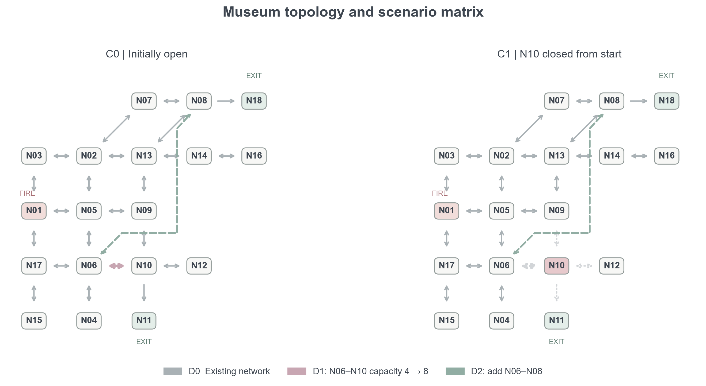
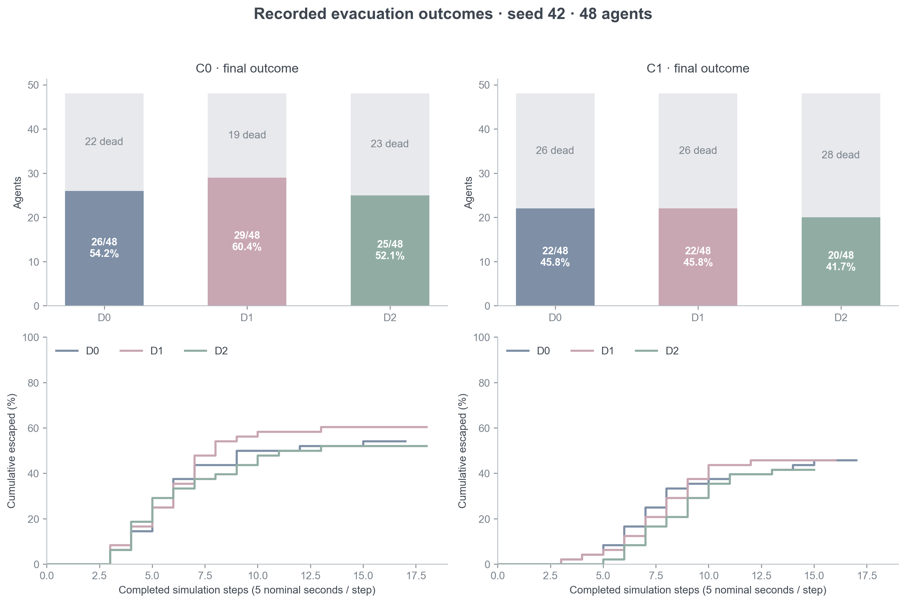
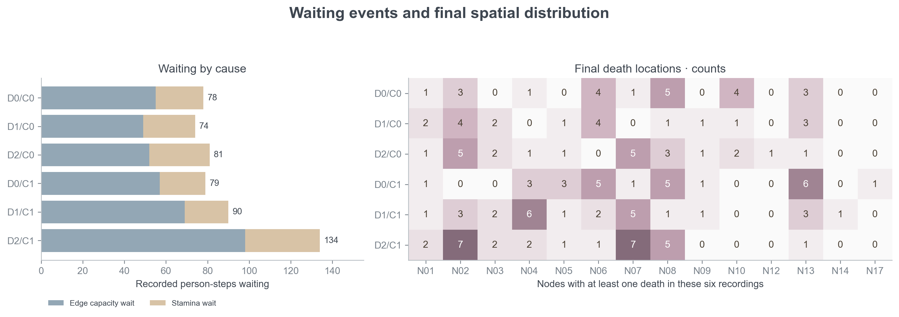

# 栖木 · 建筑疏散观察室 / Evacuation Studio

**把建筑方案、Agent 决策与疏散过程放在同一个可观察、可回放的研究环境中。**

Evacuation Studio 是面向建筑设计早期方案比选的研究原型：以 18 节点博物馆为场景，将 LLM Agent 的局部观察、空间记忆与行动选择接入具有火烟、通道容量和排队约束的仿真，再用原创 Cozy Pixel Art 界面展示全过程。

**[▶ 在线演示](https://esfec.github.io/evacuation-studio/)** · [快速启动](#快速启动) · [方案与工况](#方案与工况) · [现有录制结果](#现有录制结果) · [数据与复现](#数据与复现)

在线页面无需密钥，只播放已有记录，不调用 API。内嵌文件约 31.4 MiB，首次打开需等待加载；本地服务支持新建仿真与真实 API 调用。

当前仿真与事件服务标识为 `studio-1.5-llm-protocol`，前端为 `museum-ui-1.9`。仓库已包含 **D0/D1/D2 × C0/C1 的 6 组真实 DeepSeek 汇报录制**：每组 seed 42，共 **1,815 次 API 请求，无无效输出、无规则兜底**。详情见 [已知问题](KNOWN_ISSUES.md) 与 [变更记录](CHANGELOG.md)。


*同一 seed、同一初始位置下 D0 原始方案（左）与 D2 新增 N06↔N08 连廊（右）的 DeepSeek 录制同步回放：红牌为各房间遇难人数，底部列出遇难地点变化。*

## 方案与工况

**现有设置是 3 个设计方案 × 2 个火灾工况，共 6 个组合。**

| 类别 | 编号 | 改变什么 | 建筑设计含义 |
|---|---|---|---|
| 设计 | D0 | 原始拓扑与容量 | 比选基准 |
| 设计 | D1 | N06 印象展区 ↔ N10 紧急通道，每方向容量由 4 提高到 8 人/步 | 提高该连接的通行能力 |
| 设计 | D2 | 在 D0 上增加 N06 印象展区 ↔ N08 临时展厅双向连接，容量为每方向 4 人/步 | 检验新增连接的影响 |
| 工况 | C0 | 动态火灾，初始路径均可用 | 观察火情发展下的基本疏散过程 |
| 工况 | C1 | 动态火灾，N10 从初始时刻起关闭 | 检验关键通道失效时的疏散表现 |



*箭头表示可通行方向；淡绿色虚线是 D2 新增连接，淡粉色线是 D1 扩容位置。N11 与 N18 是出口，N01 是起火点。*

**读图要点：C1 从初始时刻关闭 N10，因此 D1 的 N06↔N10 扩容仅在 C0 中生效。D2 会同时改变 Agent 的可选路线和火烟传播所依赖的图结构。**

完整节点与参数见 [PARAMETERS.md](PARAMETERS.md)，方案定义见 [scenarios.py](01_研究源码/scenarios.py)。

## 现有录制结果

### 录制条件与可比性

以下图表使用仓库中的 [talk_data.js](02_可视化沙盒/talk_data.js)。六组均记录于 2026-10-13，标记为 `live_llm`、`completed`、`valid=true`、`quality=clean`。

| 参数 | 这批录制的实际设置 |
|---|---|
| 模型 / 策略 | DeepSeek · `deepseek-v4-flash` / `LLM_Agent` |
| 初始人群 | 48 人：Cognitive 10、Perceptual 15、Follower 23；为合成行为画像 |
| 配对条件 | seed 42；已逐字段核对六组初始 Agent 快照完全一致，除设计/工况编号外配置一致 |
| 火灾 | 起火点 N01；`fire_rate=0.1`；`smoke_rate=null`（未单独覆盖），`smoke_scale=0.9` |
| 容量 / 时间 | 基础通道容量每方向 4 人/步；每步最多一跳；5 标称秒/步；最多 30 步 |
| 调用设置 | `temperature=0.1`；`llm_concurrency=8` |
| 调用质量 | 共 1,815 次请求且均成功；无效输出、纠错重试、名称规范化、规则兜底均为 0 |

### 逃生人数与疏散进程



| 工况 | 方案 | 逃生 / 总人数 | 逃生率 | 遇难 | 逃生者中位步数 | 通道排队人步 | API 请求 |
|---|---|---:|---:|---:|---:|---:|---:|
| C0 | D0 原始 | 26 / 48 | 54.2% | 22 | 6 | 55 | 282 |
| C0 | D1 扩容 | 29 / 48 | 60.4% | 19 | 6 | 49 | 275 |
| C0 | D2 新连接 | 25 / 48 | 52.1% | 23 | 5 | 52 | 283 |
| C1 | D0 原始 | 22 / 48 | 45.8% | 26 | 7 | 57 | 315 |
| C1 | D1 扩容 | 22 / 48 | 45.8% | 26 | 8 | 69 | 328 |
| C1 | D2 新连接 | 20 / 48 | 41.7% | 28 | 8.5 | 98 | 332 |

这批录制中，D1/C0 的逃生人数最多；D2/C1 的通道排队人步最多。新增连接同时改变了路线选择、空间聚集和危险暴露过程。

六组最终均无活动中或体力耗尽状态的 Agent，人数由逃生与遇难两类构成。运行分别在 17、18、18、17、16、15 步完成状态结算。

### 等待与空间分布



左图区分“通道容量排队”和“体力等待”，本批录制没有出现 `NODE_FULL` 房间满员等待。右图展示最终遇难位置的空间分布。

### 历史实验：单独保留的证据

仓库还保留了旧实现的研究材料：120 次有效 LLM 设计实验（每组合 20 个 seed）、480 次传统策略基线，以及 40 次匹配消融记录。历史实验在独立表格中呈现。

历史 LLM 汇总表有 121 行，其中 1 行 `valid_run=False`；下表仅使用其余 120 行：

| 历史工况 | D0 平均逃生率 | D1 平均逃生率 | D2 平均逃生率 | 每方案样本数 |
|---|---:|---:|---:|---:|
| C0 | 57.2% | 57.4% | 55.2% | 20 |
| C1 | 45.4% | 45.2% | 47.6% | 20 |

历史实验中，D1/C0 与 D0/C0 的平均逃生率接近；D2/C1 的平均逃生率高于 D0/C1。该结果为后续多种子配对实验提供参考。

历史来源：[LLM 汇总 CSV](01_研究源码/results/processed/formal_design_p0_v1/paper_summary_v1.csv)、[分析报告](01_研究源码/results/processed/formal_design_p0_v1/formal_analysis_report.md)、[传统策略基线](01_研究源码/results/processed/formal_baselines_p0_v1/paper_summary_v1.csv)、[匹配消融](01_研究源码/results/processed/matched_ablation/)。

## 查看界面与回放


### 开启在线演示（仓库维护者）

仓库 **Settings → Pages → Build and deployment**：Source 选 *Deploy from a branch*，Branch 选 `main` / `(root)`，保存。约 1–2 分钟后根目录 `index.html` 会自动跳转到 `02_可视化沙盒/疏散沙盒-单文件版.html`。根目录的 `.nojekyll` 让 Pages 原样发布文件。更新录制后运行 `python 02_可视化沙盒/bundle.py` 并推送，在线演示随之更新。

## 快速启动

需要 Python 3.12。网页运行不需要 Node.js；Node.js 仅用于前端测试。

在解压后的 `evacuation-studio` 目录执行：

```text
python -m venv .venv
```

Windows PowerShell（直接使用虚拟环境解释器，无需修改执行策略）：

```powershell
.\.venv\Scripts\python.exe -m pip install -r requirements.txt
.\.venv\Scripts\python.exe start.py
```

macOS / Linux：

```bash
.venv/bin/python -m pip install -r requirements.txt
.venv/bin/python start.py
```

打开 **http://127.0.0.1:8765/**。终端需要保持运行；Ctrl+C 关闭服务。端口已占用时使用 `python start.py --port 8766`，并打开对应端口。下文 `python` 指已经安装依赖的解释器。

也可双击 `02_可视化沙盒/疏散沙盒-单文件版.html` 查看内嵌录制，无需 Python、密钥或网络；离线页面只提供回放。

## 运行与观察

1. 点击“新建运行”，选择 Local Rule 等本地策略，或 LLM Agent 真实 API 策略。
2. 设置 D0/D1/D2、C0/C1、seed、人数、初始房间、起火点、火烟传播、通道容量和 Agent 画像。
3. 创建后停在初始状态；“下一帧”执行一步，“运行”连续步进。
4. 点击 Agent 查看状态、局部观察、环境、空间记忆、动作与摘要；切换“小镇”气泡或“展示模式”。
5. 用时间轴回看；“追随实时”回到最新步。导出参数用于重新计算，导出回放用于查看已经发生的过程。

地图、陈设、门洞、人物、火焰和烟雾使用原创 Canvas 绘制。火烟特效读取仿真快照，切换动画模式不会改变仿真。

## 汇报与展示

- **★ 导览**（右上角）：按当前录制自动生成 6 幕——开馆、起火、认得路的人、跟着人群走、门口的队伍、结算。→ / Enter / 空格 / 翻页笔 PageDown 下一幕，← / PageUp 上一幕，Esc 退出。每幕文字只取自录制字段，并标注来源。
- **▥ 分屏对照**（左侧工具栏）：同步回放两份匹配录制（如 D0 / D2），高亮新增或加宽的连接，房间红牌显示遇难人数，底部面板列出遇难地点变化。本文六组已核对初始人群和共同配置。
- **画面**：出口外集合点与计数、门口排队队列、移动脚印、随风险变暗的室内照明与发光出口标志、火情封闭房间压暗、含蓄的遇难标记（淡化身影与小白花）。均为记录的表现层，不改变仿真。

离线单文件页面同样支持导览与分屏。

## 命令行

与前端使用同一参数验证和引擎。在仓库根目录：

```text
python 02_可视化沙盒/run_cli.py --config examples/local-smoke.json --output work-runs
python 02_可视化沙盒/run_cli.py --fire-origin N06 --fire-rate 0.08 --smoke-rate 0.12 --cognitive 2 --perceptual 1 --follower 1 --steps 10 --seed 42
python 02_可视化沙盒/run_cli.py --config examples/local-smoke.json --validate-only --output work-runs
python 02_可视化沙盒/run_cli.py --help
```

每次输出独立运行目录，包含 `settings.json`、`replay.json`、`events.jsonl` 和 `research/` CSV 日志。首次使用可选择本地策略，无需 API。

## 真实 LLM 调用

在页面选择 LLM Agent，填写服务商、实际可用的模型名称和本次运行密钥。也可以先在启动服务的终端设置环境变量，例如 PowerShell：

```powershell
$env:DEEPSEEK_API_KEY="YOUR_API_KEY"
python start.py
```

命令行例子：

```text
python 02_可视化沙盒/run_cli.py --policy LLM_Agent --provider DeepSeek --model deepseek-v4-flash --api-key-env DEEPSEEK_API_KEY --steps 3 --cognitive 1 --perceptual 1 --follower 1 --output work-runs
```

LLM 输出协议（studio-1.5）：`target_id` 只在本步可选方向内做确定性匹配（精确 ID、大小写、文本中唯一 ID、唯一房间名），歧义一律视为无效；无效输出重试时附上一条回复与协议纠正。每次匹配方式和纠错重试写入 `llm_call_log`，回放附 `llm_protocol` 汇总；导览结算显示 LLM 采纳、恐慌改写与规则兜底的构成。

以下命令用于重新录制汇报矩阵。默认 D0 / D1 / D2 × C0 / C1，seed 42，完成后自动重建离线页面：

```powershell
$env:DEEPSEEK_API_KEY="YOUR_API_KEY"
.\.venv\Scripts\python.exe 02_可视化沙盒\record_talk_runs.py --dry-run   # 本地规则，跑通流程
.\.venv\Scripts\python.exe 02_可视化沙盒\record_talk_runs.py             # 真实调用
```

结果写入 `02_可视化沙盒/talk_data.js`，页面录制列表顶部显示为“汇报录制”。`--dry-run` 写入 `talk_data_dryrun.js`；`--rerun` 全部重录。脚本按设计、工况、seed、策略、模型及实现版本复用已有录制，只补充缺失组合。

`.env.example` 列出环境变量名称；LLM 调用使用启动进程中的环境变量。模型名称按服务商账号中的可用模型填写。

### Agent 气泡是不是 LLM 的思考？

真实调用、规则策略、恐慌覆盖、规则兜底和录制回放均有记录标识。气泡与详情面板应结合来源阅读：

| 显示内容 | 来源 | 代表什么 |
|---|---|---|
| 模型原始摘要 | LLM 返回的 `brief_justification` | 该次模型给出的简短决策说明 |
| 记录综合解说 | 前端综合已记录的观察、状态、环境、记忆与行动 | 便于展示的过程解说，不是新增一次 LLM 调用 |
| 实际行动与状态 | 仿真执行后的快照和事件 | 是否走动、排队、等待、逃生或遇难 |

LLM 目标、规则修正与最终行动分别保存，便于对照模型选择和仿真执行结果。

## 数据与复现

### 仓库中有哪些数据

| 内容 | 位置 | 用途 |
|---|---|---|
| 当前真实 LLM 录制，6 组 | `02_可视化沙盒/talk_data.js` | 本文图表、导览、分屏及逐步观察的数据源 |
| 本地规则录制，6 组 | `02_可视化沙盒/studio_data.js` | 无密钥演示与策略对照 |
| 交接包历史录制，24 组 | `02_可视化沙盒/replay_data.js` | 旧版本回放，页面区分来源 |
| 历史研究汇总与图表 | `01_研究源码/results/processed/`、`01_研究源码/figures/` | 旧实验再分析与研究追溯 |
| 本文汇总与来源校验 | [recorded-summary.csv](media/readme/recorded-summary.csv)、[provenance.json](media/readme/provenance.json) | 六组完整 run ID、指标、源文件 SHA-256 和配对核对结果 |

完整运行目录默认保留在本地并被 Git 忽略。每次运行的 API 提示、响应和逐步记录保存在对应原始日志中。

### 不调用 API，重新生成本文图表

在仓库根目录使用已安装依赖的 Python：

```text
python -m pip install -r requirements-figures.txt
python scripts/build_readme_figures.py
```

脚本读取已提交的 `talk_data.js`，输出 `media/readme/` 下的 PNG、SVG、汇总 CSV 和来源 JSON；同时检查六个组合、初始 Agent、共同配置、逐步人数守恒和时间轴。可编辑矢量图：[工况](media/readme/scenarios.svg) · [结果](media/readme/recorded-results.svg) · [过程诊断](media/readme/recorded-diagnostics.svg)。

### 保存一次新实验

一次完整的本地运行可保留：

```text
<运行目录>/
  settings.json       # 运行参数
  replay.json         # 拓扑、逐步快照、事件及质量标记
  events.jsonl        # 事件序列
  research/           # 汇总及逐 Agent / 节点 / 通道 / LLM 调用 CSV
```

研究复现同时记录代码提交、模型名称、参数、seed、初始人群、调用质量和原始回放。回放用于重现已记录过程；重新调用 API 会产生一份新的独立运行记录。

## 研究界面和批量工具

可选的原 Streamlit 界面：

```text
python -m pip install -r 01_研究源码/requirements.txt
python -m streamlit run 01_研究源码/app.py --server.address 127.0.0.1 --server.port 8501
```

批量实验、画像校准、LLM 日志审计和历史紧凑数据再分析入口见 [研究源码说明](01_研究源码/README.md)。`results/processed/` 和 `figures/` 保存历史研究材料，`evidence/` 保存协议审计摘要。

## 测试

```text
python -m pip install -r requirements-dev.txt
python -m pytest 01_研究源码/tests 02_可视化沙盒/tests scripts/tests -q
python scripts/verify_package.py
```

测试不会调用付费 API。依赖未分发原始历史日志的测试会明确跳过。

`verify_package.py` 检查当前工作版本的启动与本地运行；`--verify-manifest` 核对发布快照中的文件哈希。

前端摘要与特效单元检查：

```text
cd 02_可视化沙盒
node tests/narrative.cjs
node tests/scene-effects.cjs
```

浏览器测试另需 Node.js 20+、Playwright 和 Chromium：

```text
npm ci
npx playwright install chromium
```

先在另一终端启动根目录 `start.py`，使用默认 8765 端口，再在前端目录执行：

```text
node tests/visual-context.cjs
node tests/building-layout.cjs
node tests/effects-browser.cjs
```

另可从根目录执行 `node scripts/verify_browser.cjs` 检查本包网页、两种 16:9 尺寸、离线页面与真实本地仿真。它默认使用前端子目录安装的 Playwright；其他安装位置可设置 `PLAYWRIGHT_MODULE`，非默认端口使用 `STUDIO_URL`。

`tests/browser.cjs` 保留的是早期 UI 的完整流程测试，其中个别气泡文字断言已不符合 1.4 综合摘要；当前界面检查使用上面的新版测试。GitHub Actions 配置检查 Python 测试、无 API 的启动与 CLI 冒烟测试，以及前端摘要和特效单元检查。

## 仓库结构

| 路径 | 内容 |
|---|---|
| `start.py` | 像素界面启动入口 |
| `01_研究源码/` | 仿真、策略、容量仲裁、LLM 接口、记录器、Streamlit、研究工具和测试 |
| `02_可视化沙盒/` | HTML/CSS/JS 前端、HTTP/SSE 服务、CLI、字体、演示和浏览器测试 |
| `examples/` | 无密钥的可运行示例配置 |
| `scripts/` | 交付检查与 README 图表重建脚本 |
| `media/readme/` | 当前六组录制的图表、汇总数据与来源校验 |
| `evidence/` | 既有测试与当前打包验证、最近 DeepSeek 审计摘要 |
| `.github/workflows/` | 自动检查配置 |
| `RELEASE_MANIFEST.json` | 文件 SHA-256 与来源说明 |

完整参数见 [PARAMETERS.md](PARAMETERS.md)，事件与快照见 [EVENT_PROTOCOL.md](EVENT_PROTOCOL.md)，机制说明见 [FINAL_MECHANISM_AUDIT.md](FINAL_MECHANISM_AUDIT.md)，画面与素材见 [ASSETS.md](ASSETS.md)。

## 素材与许可

博物馆地图、陈设、人物与特效采用原创 Canvas 绘制。字体信息及素材说明见 [ASSETS.md](ASSETS.md)，Fusion Pixel 字体许可见 [LICENSE-font.txt](02_可视化沙盒/font/LICENSE-font.txt)。

## 文档导航

| 想了解什么 | 文档 |
|---|---|
| 参数、人数、起火点、初始位置 | [PARAMETERS.md](PARAMETERS.md) |
| 快照与实时同步协议 | [EVENT_PROTOCOL.md](EVENT_PROTOCOL.md) |
| 机制审查与版本记录 | [FINAL_MECHANISM_AUDIT.md](FINAL_MECHANISM_AUDIT.md)、[KNOWN_ISSUES.md](KNOWN_ISSUES.md) |
| 导览、分屏与场景表现 | [UI_TOUR_1_7.md](UI_TOUR_1_7.md) |
| 历史实验与批量工具 | [研究源码说明](01_研究源码/README.md) |
| 版本改动 | [CHANGELOG.md](CHANGELOG.md) |
