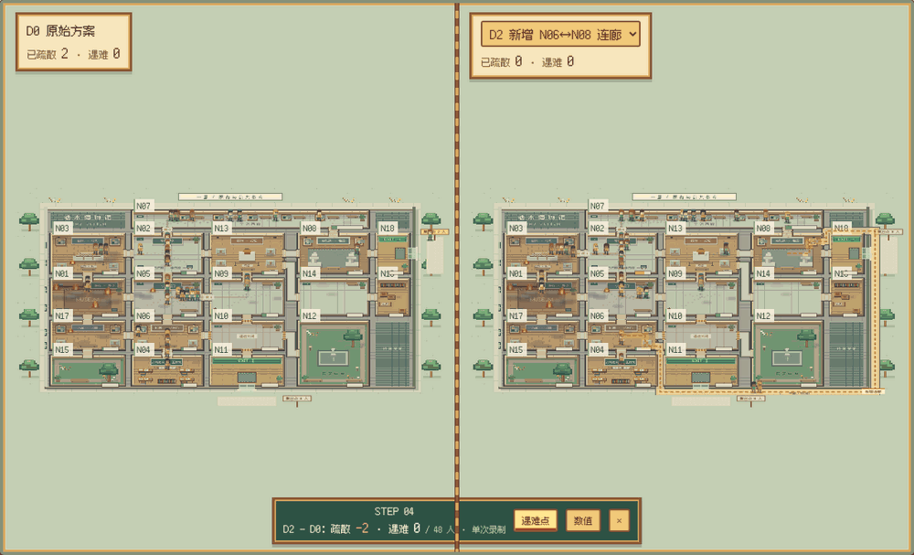
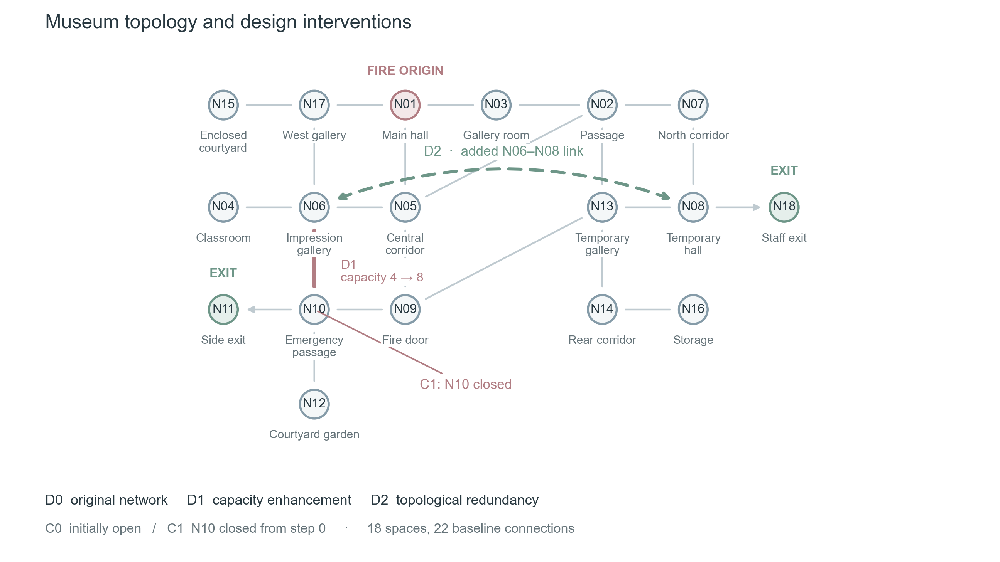
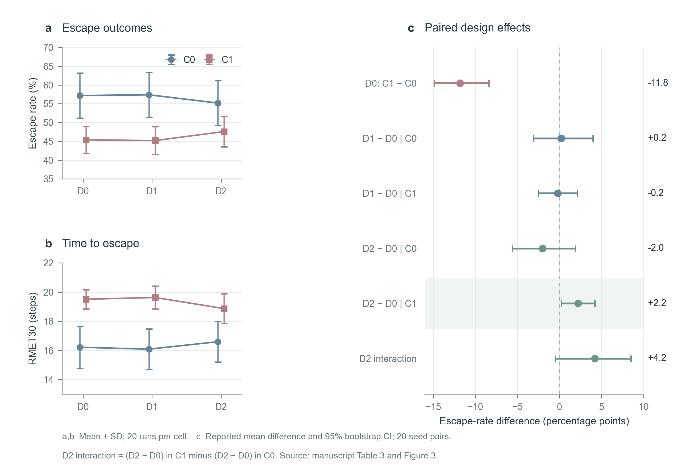
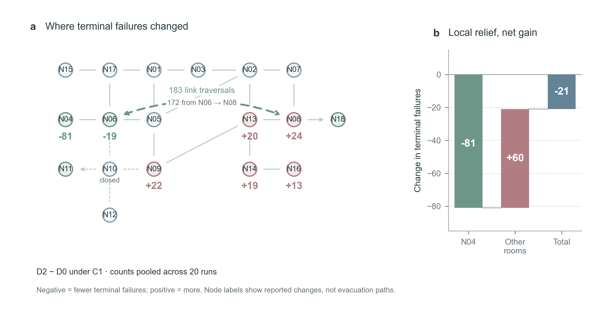
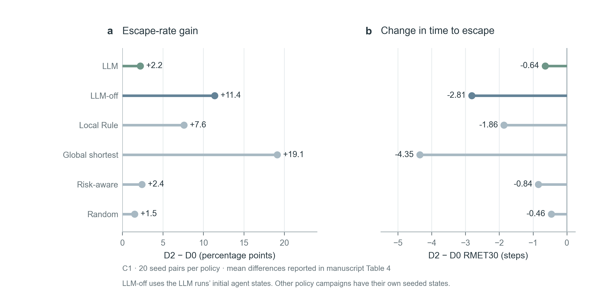
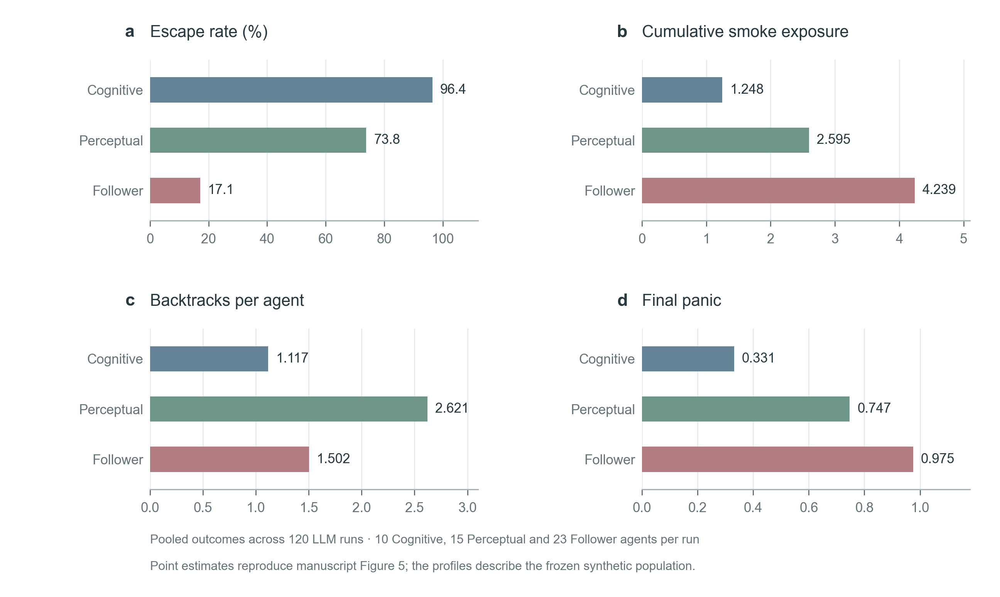

# 栖木 · 建筑疏散观察室 / Evacuation Studio

**把建筑方案、Agent 决策与疏散过程放在同一个可观察、可回放的研究环境中。**

Evacuation Studio 是面向建筑设计早期方案比选的研究原型：以 18 节点博物馆为场景，将 LLM Agent 的局部观察、空间记忆与行动选择接入具有火烟、通道容量和排队约束的仿真，再用原创 Cozy Pixel Art 界面展示全过程。

**[▶ 在线演示](https://esfec.github.io/evacuation-studio/)** · [快速启动](#快速启动) · [方案与工况](#方案与工况) · [多 seed 实验结果](#多-seed-实验结果) · [数据与复现](#数据与复现)

在线页面无需密钥，只播放已有记录，不调用 API。内嵌文件约 31.4 MiB，首次打开需等待加载；本地服务支持新建仿真与真实 API 调用。

研究结果采用已归档的 **120 次有效 LLM 运行、480 次传统策略运行和 40 次匹配消融运行**，覆盖 D0/D1/D2 × C0/C1、seeds 101–120。下面的图表按论文的统计口径重绘，沿用论文报告的数值、20 seed 分析及误差线定义。

当前仿真与事件服务标识为 `studio-1.5-llm-protocol`，前端为 `museum-ui-1.9`。在线演示使用 2026-10-13 的六组 DeepSeek 录制：每组 seed 42，共 1,815 次请求。演示可用于观察过程，统计图采用归档的冻结 P0 实验。版本信息见 [已知问题](KNOWN_ISSUES.md) 与 [变更记录](CHANGELOG.md)。



*同一 seed、同一初始位置下 D0 原始方案（左）与 D2 新增 N06↔N08 连廊（右）的 DeepSeek 录制同步回放：红牌为各房间遇难人数，底部列出遇难地点变化。*

## 方案与工况

**现有设置是 3 个设计方案 × 2 个火灾工况，共 6 个组合。**

| 类别 | 编号 | 改变什么 | 建筑设计含义 |
|---|---|---|---|
| 设计 | D0 | 原始拓扑与容量 | 比选基准 |
| 设计 | D1 | 扩容 N06 印象展区—N10 紧急通道连接，通行容量由 4 提高到 8 人/步 | 提高该连接的通行能力 |
| 设计 | D2 | 在 D0 上增加 N06 印象展区 ↔ N08 临时展厅双向连接，容量为每方向 4 人/步 | 检验新增连接的影响 |
| 工况 | C0 | 动态火灾，初始路径均可用 | 观察火情发展下的基本疏散过程 |
| 工况 | C1 | 动态火灾，N10 从初始时刻起关闭 | 检验关键通道失效时的疏散表现 |



*图1｜按论文图2重绘的语义拓扑：18个空间节点、22条基础连接。灰线为原有连接，灰绿色虚线为 D2 新增连接，灰粉色线为 D1 扩容位置；N11/N18 为出口，N01 为起火点。图中位置用于说明连通关系。*

**读图要点：C1 从初始时刻关闭 N10，因此 D1 的 N06↔N10 扩容仅在 C0 中生效。D2 会同时改变 Agent 的可选路线和火烟传播所依赖的图结构。**

完整节点与参数见 [PARAMETERS.md](PARAMETERS.md)，方案定义见 [scenarios.py](01_研究源码/scenarios.py)。

## 多 seed 实验结果

本节对应论文 *LLM-Agent-Based Comparative Screening of Early-Stage Fire-Egress Designs* 的表3、表4及图3—5。图表采用论文报告值与原有20 seed分析口径，表中小数精度与论文一致。

### 实验设置

| 项目 | 设置 |
|---|---|
| 模型 / 策略 | DeepSeek · `deepseek-v4-flash` / `LLM_Agent` |
| 实验矩阵 | D0/D1/D2 × C0/C1 × seeds 101–120；共120次有效 LLM 运行 |
| 人群 | 每次48人：Cognitive 10、Perceptual 15、Follower 23；冻结 P0 画像 |
| 场景 | 18节点博物馆；N01 起火，N11/N18 为出口 |
| 时间设置 | 最多30步，5标称秒/步 |
| 策略对照 | 480次传统策略运行；40次匹配 LLM-off 消融运行 |
| 误差线 | 组合结果：均值 ± 标准差（SD）；配对效应：论文报告的95% bootstrap置信区间 |
| 配对分析 | 沿用论文的20 seed口径；原分析采用20,000次bootstrap重采样 |

**三个主要发现：** D1 扩容对整体逃生率的影响较小；D2 新增连接在 C1 下减少等待并降低 RMET30；N04 的局部改善伴随其他空间风险重新分布。

### 总体表现与设计效应



*图2｜总体疏散表现。a，逃生率；b，RMET30；两图均为20次运行的均值 ± SD。c，相对 D0 的设计效应、D0 的工况扰动效应及 D2 的交互效应，线段表示论文报告的95% bootstrap置信区间。交互效应为 `(D2−D0)|C1 − (D2−D0)|C0`。*

**RMET30** 将已逃生者记为其逃生步数，未逃生者记为30步，再对全体人员取均值；数值越低，表示在统一观察窗口内的疏散表现越好。

| 方案 / 工况 | 逃生率，均值（SD） | RMET30，步，均值（SD） | 烟雾暴露，均值（SD） | 等待事件 / 轮 | 回退次数 / 人 |
|---|---:|---:|---:|---:|---:|
| D0/C0 | 0.572（0.060） | 16.22（1.44） | 2.854（0.262） | 191.85 | 1.585 |
| D0/C1 | 0.454（0.036） | 19.51（0.66） | 3.325（0.115） | 203.60 | 1.926 |
| D1/C0 | 0.574（0.060） | 16.09（1.38） | 2.794（0.221） | 183.65 | 1.513 |
| D1/C1 | 0.452（0.037） | 19.63（0.79） | 3.422（0.181） | 204.25 | 2.119 |
| D2/C0 | 0.552（0.060） | 16.60（1.38） | 2.908（0.200） | 184.10 | 1.607 |
| D2/C1 | 0.476（0.041） | 18.87（1.01） | 3.311（0.208） | 193.15 | 1.878 |

逃生率用0—1比例表示，例如0.572约为57.2%；等待为每轮累计等待/受阻事件，烟雾为每轮全体人员的平均累计相对暴露。数据对应论文表3。

| 比较 | 逃生率变化，百分点 | 95% bootstrap置信区间 |
|---|---:|---:|
| D0：C1 − C0 | -11.8 | -14.9 至 -8.4 |
| C0：D1 − D0 | +0.2 | -3.1 至 +4.0 |
| C1：D1 − D0 | -0.2 | -2.5 至 +2.1 |
| C0：D2 − D0 | -2.0 | -5.6 至 +1.9 |
| C1：D2 − D0 | +2.2 | +0.2 至 +4.2 |
| D2 交互效应 | +4.2 | -0.5 至 +8.5 |

在 C1 下，D2 的平均逃生率比 D0 高 **2.2个百分点**，每轮等待事件减少 **10.45次**，RMET30 降低 **0.64步**。论文报告的逃生率 Wilcoxon 检验为 *p*=0.101，RMET30 为 *p*=0.015：时间和等待指标为设计改善提供了更清楚的证据。

### 局部改善与空间风险转移



*图3｜C1 下 D2 相比 D0 的空间变化。a，论文报告的各节点终态未逃生人数变化，灰绿色表示减少，灰粉色表示增加；虚线为新增 N06↔N08 连接。b，N04、其他全部房间与整体变化的数量关系。均为20次运行的累计人次。*

| 空间范围 | D0 未逃生人次 | D2 未逃生人次 | D2 − D0 |
|---|---:|---:|---:|
| N04 教室 | 128 | 47 | −81 |
| 其他所有房间 | 396 | 456 | +60 |
| 全部房间 | 524 | 503 | −21 |

新增连接累计被经过 **183次**，其中 **172次为 N06→N08**。N04 的未逃生人数累计减少81人次，而其他空间净增60人次，整体减少21人次。N08、N13、N14、N09、N16 分别增加24、20、19、22、13人次；这些节点的增量与其他节点的减量共同形成整体结果。

这说明，早期设计比选需要同时观察**整体结果、等待过程和风险落点**。新增连接可以缓解局部滞留，也会改变下游空间承受的人流与风险。

### 决策策略如何影响方案评价



*图4｜六种决策策略在 C1 下的 D2−D0 平均效应，每种策略20组seed。左：逃生率变化；右：RMET30变化。点值对应论文表4。LLM-off 与 LLM 使用一致的初始 Agent 状态；其他策略使用各自实验批次的seed初始化。*

| 决策策略 | 逃生率变化，百分点 | RMET30变化，步 | N04未逃生变化，人/轮 | 下游累计占用变化，人·步/轮 | 下游未逃生变化，人/轮 | 新连接经过次数 |
|---|---:|---:|---:|---:|---:|---:|
| LLM | +2.2 | -0.64 | -4.05 | +34.45 | +4.90 | 183 |
| LLM-off | +11.4 | -2.81 | -5.65 | +41.45 | +3.65 | 303 |
| Local Rule | +7.6 | -1.86 | -4.70 | +44.70 | +3.95 | 263 |
| Global shortest | +19.1 | -4.35 | +0.05 | +109.30 | +1.95 | 472 |
| Risk-aware | +2.4 | -0.84 | +0.15 | -1.10 | +1.05 | 472 |
| Random | +1.5 | -0.46 | -2.70 | +24.40 | +2.95 | 278 |

下游分支包括 N08、N13、N14、N16、N09。各策略均呈现 D2 的平均逃生率收益，但幅度不同：全局最短路径为 **+19.1个百分点**，LLM-off 为 **+11.4个百分点**，LLM 为 **+2.2个百分点**。这表明，对局部感知、行为差异及决策过程的建模，会改变对同一设计调整的效应估计。

### 人群画像与行为差异



*图5｜冻结 P0 人群画像的汇总表现。a，逃生率；b，累计烟雾暴露；c，回退次数；d，终态恐慌值。点估计汇总120次 LLM 运行，对应论文图5。*

| 画像 | 每轮人数 | 逃生率 | 烟雾暴露 | 回退次数 | 终态恐慌 |
|---|---:|---:|---:|---:|---:|
| Cognitive | 10 | 96.4% | 1.248 | 1.117 | 0.331 |
| Perceptual | 15 | 73.8% | 2.595 | 2.621 | 0.747 |
| Follower | 23 | 17.1% | 4.239 | 1.502 | 0.975 |

Cognitive 画像的逃生率最高，Follower 画像承受更高的烟雾暴露与终态恐慌；Perceptual 画像的回退次数最多。四项指标共同展示了冻结画像在本模型中的不同疏散过程。

图表数值与出处见 [论文图表源数据](media/readme/paper-source-data.json)；归档数据核对、seed 117 的初始分配差异及独立复算见 [实验数据来源说明](media/readme/EXPERIMENT_SOURCE_AUDIT.md)。

## 查看界面与回放


### 开启在线演示（仓库维护者）

仓库 **Settings → Pages → Build and deployment**：Source 选 *Deploy from a branch*，Branch 选 `main` / `(root)`，保存。约 1–2 分钟后根目录 `index.html` 会自动跳转到 `02_可视化沙盒/疏散沙盒-单文件版.html`。根目录的 `.nojekyll` 让 Pages 原样发布文件。更新录制后运行 `python 02_可视化沙盒/bundle.py` 并推送，在线演示随之更新。

## 快速启动

需要 Python 3.12。网页运行不需要 Node.js；Node.js 仅用于前端测试。

在解压后的 `evacuation-studio` 目录执行：

```text
python -m venv .venv
```

Windows PowerShell（直接使用虚拟环境解释器，无需修改执行策略）：

```powershell
.\.venv\Scripts\python.exe -m pip install -r requirements.txt
.\.venv\Scripts\python.exe start.py
```

macOS / Linux：

```bash
.venv/bin/python -m pip install -r requirements.txt
.venv/bin/python start.py
```

打开 **http://127.0.0.1:8765/**。终端需要保持运行；Ctrl+C 关闭服务。端口已占用时使用 `python start.py --port 8766`，并打开对应端口。下文 `python` 指已经安装依赖的解释器。

也可双击 `02_可视化沙盒/疏散沙盒-单文件版.html` 查看内嵌录制，无需 Python、密钥或网络；离线页面只提供回放。

## 运行与观察

1. 点击“新建运行”，选择 Local Rule 等本地策略，或 LLM Agent 真实 API 策略。
2. 设置 D0/D1/D2、C0/C1、seed、人数、初始房间、起火点、火烟传播、通道容量和 Agent 画像。
3. 创建后停在初始状态；“下一帧”执行一步，“运行”连续步进。
4. 点击 Agent 查看状态、局部观察、环境、空间记忆、动作与摘要；切换“小镇”气泡或“展示模式”。
5. 用时间轴回看；“追随实时”回到最新步。导出参数用于重新计算，导出回放用于查看已经发生的过程。

地图、陈设、门洞、人物、火焰和烟雾使用原创 Canvas 绘制。火烟特效读取仿真快照，切换动画模式不会改变仿真。

## 汇报与展示

- **★ 导览**（右上角）：按当前录制自动生成 6 幕——开馆、起火、认得路的人、跟着人群走、门口的队伍、结算。→ / Enter / 空格 / 翻页笔 PageDown 下一幕，← / PageUp 上一幕，Esc 退出。每幕文字只取自录制字段，并标注来源。
- **▥ 分屏对照**（左侧工具栏）：同步回放两份匹配录制（如 D0 / D2），高亮新增或加宽的连接，房间红牌显示遇难人数，底部面板列出遇难地点变化。本文六组已核对初始人群和共同配置。
- **画面**：出口外集合点与计数、门口排队队列、移动脚印、随风险变暗的室内照明与发光出口标志、火情封闭房间压暗、含蓄的遇难标记（淡化身影与小白花）。均为记录的表现层，不改变仿真。

离线单文件页面同样支持导览与分屏。

## 命令行

与前端使用同一参数验证和引擎。在仓库根目录：

```text
python 02_可视化沙盒/run_cli.py --config examples/local-smoke.json --output work-runs
python 02_可视化沙盒/run_cli.py --fire-origin N06 --fire-rate 0.08 --smoke-rate 0.12 --cognitive 2 --perceptual 1 --follower 1 --steps 10 --seed 42
python 02_可视化沙盒/run_cli.py --config examples/local-smoke.json --validate-only --output work-runs
python 02_可视化沙盒/run_cli.py --help
```

每次输出独立运行目录，包含 `settings.json`、`replay.json`、`events.jsonl` 和 `research/` CSV 日志。首次使用可选择本地策略，无需 API。

## 真实 LLM 调用

在页面选择 LLM Agent，填写服务商、实际可用的模型名称和本次运行密钥。也可以先在启动服务的终端设置环境变量，例如 PowerShell：

```powershell
$env:DEEPSEEK_API_KEY="YOUR_API_KEY"
python start.py
```

命令行例子：

```text
python 02_可视化沙盒/run_cli.py --policy LLM_Agent --provider DeepSeek --model deepseek-v4-flash --api-key-env DEEPSEEK_API_KEY --steps 3 --cognitive 1 --perceptual 1 --follower 1 --output work-runs
```

LLM 输出协议（studio-1.5）：`target_id` 只在本步可选方向内做确定性匹配（精确 ID、大小写、文本中唯一 ID、唯一房间名），歧义一律视为无效；无效输出重试时附上一条回复与协议纠正。每次匹配方式和纠错重试写入 `llm_call_log`，回放附 `llm_protocol` 汇总；导览结算显示 LLM 采纳、恐慌改写与规则兜底的构成。

以下命令用于重新录制汇报矩阵。默认 D0 / D1 / D2 × C0 / C1，seed 42，完成后自动重建离线页面：

```powershell
$env:DEEPSEEK_API_KEY="YOUR_API_KEY"
.\.venv\Scripts\python.exe 02_可视化沙盒\record_talk_runs.py --dry-run   # 本地规则，跑通流程
.\.venv\Scripts\python.exe 02_可视化沙盒\record_talk_runs.py             # 真实调用
```

结果写入 `02_可视化沙盒/talk_data.js`，页面录制列表顶部显示为“汇报录制”。`--dry-run` 写入 `talk_data_dryrun.js`；`--rerun` 全部重录。脚本按设计、工况、seed、策略、模型及实现版本复用已有录制，只补充缺失组合。

`.env.example` 列出环境变量名称；LLM 调用使用启动进程中的环境变量。模型名称按服务商账号中的可用模型填写。

### Agent 气泡是不是 LLM 的思考？

真实调用、规则策略、恐慌覆盖、规则兜底和录制回放均有记录标识。气泡与详情面板应结合来源阅读：

| 显示内容 | 来源 | 代表什么 |
|---|---|---|
| 模型原始摘要 | LLM 返回的 `brief_justification` | 该次模型给出的简短决策说明 |
| 记录综合解说 | 前端综合已记录的观察、状态、环境、记忆与行动 | 便于展示的过程解说，不是新增一次 LLM 调用 |
| 实际行动与状态 | 仿真执行后的快照和事件 | 是否走动、排队、等待、逃生或遇难 |

LLM 目标、规则修正与最终行动分别保存，便于对照模型选择和仿真执行结果。

## 数据与复现

### 仓库中有哪些数据

| 内容 | 位置 | 用途 |
|---|---|---|
| 冻结 P0 多 seed 实验 | `01_研究源码/results/processed/formal_design_p0_v1/` | 本文主要统计结果，120 次有效 LLM 运行 |
| 基线与消融 | `01_研究源码/results/processed/formal_baselines_p0_v1/`、`matched_ablation/` | 480 次基线、40 次消融及空间诊断 |
| 当前真实 LLM 录制，6 组 | `02_可视化沙盒/talk_data.js` | seed 42，导览、分屏及逐步观察 |
| 本地规则录制，6 组 | `02_可视化沙盒/studio_data.js` | 无密钥演示与策略对照 |
| 交接包历史录制，24 组 | `02_可视化沙盒/replay_data.js` | 旧版本回放，页面区分来源 |
| 历史研究汇总与图表 | `01_研究源码/results/processed/`、`01_研究源码/figures/` | 旧实验再分析与研究追溯 |
| 本文论文图表数据 | [paper-source-data.json](media/readme/paper-source-data.json) | 五组图与结果表的统一源数据，含论文来源哈希 |
| 数据审计 | [来源说明](media/readme/EXPERIMENT_SOURCE_AUDIT.md)、[来源清单](media/readme/formal-provenance.json) | 原始汇总复核、配对差异及源文件 SHA-256 |
| 演示录制摘要 | [recorded-summary.csv](media/readme/recorded-summary.csv)、[provenance.json](media/readme/provenance.json) | 六组 seed 42 录制的 run ID 与过程指标 |

完整运行目录默认保留在本地并被 Git 忽略。每次运行的 API 提示、响应和逐步记录保存在对应原始日志中。

### 不调用 API，重新生成本文图表

在仓库根目录使用已安装依赖的 Python：

```text
python -m pip install -r requirements-figures.txt
python scripts/build_paper_readme_figures.py
```

默认只更新 README 使用的5张PNG。图中均值、SD、区间端点和配对分析均沿用论文报告值，统一源数据为 [paper-source-data.json](media/readme/paper-source-data.json)。

需要可编辑SVG、矢量PDF或CSV时，再生成完整导出包：

```text
python scripts/build_paper_readme_figures.py --exports
```

文件保存在 `local-exports/paper-figures/`，包含五组PNG/SVG/PDF、六份CSV和导出清单。该目录已被Git忽略，可用于汇报与排版。

归档数据的独立复算使用 `python scripts/build_formal_readme_figures.py`，输出至 `local-exports/formal-audit/`，保留 C0 的19组匹配分析；具体统计口径见 [实验数据来源说明](media/readme/EXPERIMENT_SOURCE_AUDIT.md)。seed 42 演示图仍可通过 `python scripts/build_readme_figures.py` 重建。

### 保存一次新实验

一次完整的本地运行可保留：

```text
<运行目录>/
  settings.json       # 运行参数
  replay.json         # 拓扑、逐步快照、事件及质量标记
  events.jsonl        # 事件序列
  research/           # 汇总及逐 Agent / 节点 / 通道 / LLM 调用 CSV
```

研究复现同时记录代码提交、模型名称、参数、seed、初始人群、调用质量和原始回放。回放用于重现已记录过程；重新调用 API 会产生一份新的独立运行记录。

## 研究界面和批量工具

可选的原 Streamlit 界面：

```text
python -m pip install -r 01_研究源码/requirements.txt
python -m streamlit run 01_研究源码/app.py --server.address 127.0.0.1 --server.port 8501
```

批量实验、画像校准、LLM 日志审计和历史紧凑数据再分析入口见 [研究源码说明](01_研究源码/README.md)。`results/processed/` 和 `figures/` 保存历史研究材料，`evidence/` 保存协议审计摘要。

## 测试

```text
python -m pip install -r requirements-dev.txt
python -m pytest 01_研究源码/tests 02_可视化沙盒/tests scripts/tests -q
python scripts/verify_package.py
```

测试不会调用付费 API。依赖未分发原始历史日志的测试会明确跳过。

`verify_package.py` 检查当前工作版本的启动与本地运行；`--verify-manifest` 核对发布快照中的文件哈希。

前端摘要与特效单元检查：

```text
cd 02_可视化沙盒
node tests/narrative.cjs
node tests/scene-effects.cjs
```

浏览器测试另需 Node.js 20+、Playwright 和 Chromium：

```text
npm ci
npx playwright install chromium
```

先在另一终端启动根目录 `start.py`，使用默认 8765 端口，再在前端目录执行：

```text
node tests/visual-context.cjs
node tests/building-layout.cjs
node tests/effects-browser.cjs
```

另可从根目录执行 `node scripts/verify_browser.cjs` 检查本包网页、两种 16:9 尺寸、离线页面与真实本地仿真。它默认使用前端子目录安装的 Playwright；其他安装位置可设置 `PLAYWRIGHT_MODULE`，非默认端口使用 `STUDIO_URL`。

`tests/browser.cjs` 保留的是早期 UI 的完整流程测试，其中个别气泡文字断言已不符合 1.4 综合摘要；当前界面检查使用上面的新版测试。GitHub Actions 配置检查 Python 测试、无 API 的启动与 CLI 冒烟测试，以及前端摘要和特效单元检查。

## 仓库结构

| 路径 | 内容 |
|---|---|
| `start.py` | 像素界面启动入口 |
| `01_研究源码/` | 仿真、策略、容量仲裁、LLM 接口、记录器、Streamlit、研究工具和测试 |
| `02_可视化沙盒/` | HTML/CSS/JS 前端、HTTP/SSE 服务、CLI、字体、演示和浏览器测试 |
| `examples/` | 无密钥的可运行示例配置 |
| `scripts/` | 交付检查与 README 图表重建脚本 |
| `media/readme/` | 多 seed 统计图、汇总、来源核查，以及演示录制摘要 |
| `evidence/` | 既有测试与当前打包验证、最近 DeepSeek 审计摘要 |
| `.github/workflows/` | 自动检查配置 |
| `RELEASE_MANIFEST.json` | 文件 SHA-256 与来源说明 |

完整参数见 [PARAMETERS.md](PARAMETERS.md)，事件与快照见 [EVENT_PROTOCOL.md](EVENT_PROTOCOL.md)，机制说明见 [FINAL_MECHANISM_AUDIT.md](FINAL_MECHANISM_AUDIT.md)，画面与素材见 [ASSETS.md](ASSETS.md)。

## 素材与许可

博物馆地图、陈设、人物与特效采用原创 Canvas 绘制。字体信息及素材说明见 [ASSETS.md](ASSETS.md)，Fusion Pixel 字体许可见 [LICENSE-font.txt](02_可视化沙盒/font/LICENSE-font.txt)。

## 文档导航

| 想了解什么 | 文档 |
|---|---|
| 参数、人数、起火点、初始位置 | [PARAMETERS.md](PARAMETERS.md) |
| 快照与实时同步协议 | [EVENT_PROTOCOL.md](EVENT_PROTOCOL.md) |
| 机制审查与版本记录 | [FINAL_MECHANISM_AUDIT.md](FINAL_MECHANISM_AUDIT.md)、[KNOWN_ISSUES.md](KNOWN_ISSUES.md) |
| 导览、分屏与场景表现 | [UI_TOUR_1_7.md](UI_TOUR_1_7.md) |
| 历史实验与批量工具 | [研究源码说明](01_研究源码/README.md) |
| 版本改动 | [CHANGELOG.md](CHANGELOG.md) |
