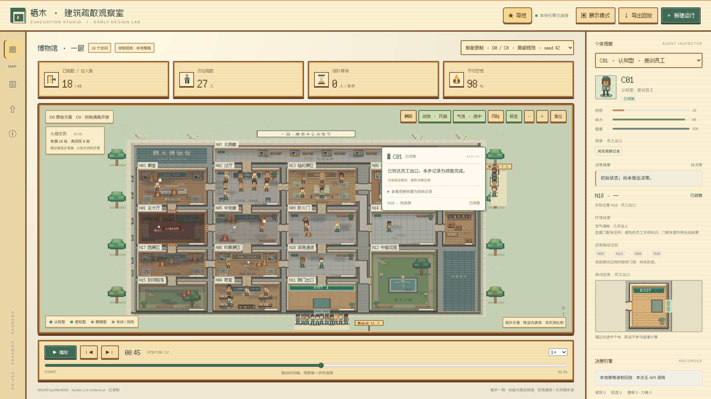

# 栖木 · 建筑疏散观察室 / Evacuation Studio

一个将 LLM Agent、18 节点博物馆拓扑疏散仿真与原创 Cozy Pixel Art 观察界面结合的研究原型。支持方案比选、局部观察、空间记忆、容量排队、逐步记录与回放。

本包对应 **2026-10-13 的当前代码**：仿真与事件服务标识 `studio-1.5-llm-protocol`，前端 `museum-ui-1.9`。DeepSeek 目标字段协议已修复，但新协议尚未用真实 API 重跑，见 [KNOWN_ISSUES.md](KNOWN_ISSUES.md)。变更见 [CHANGELOG.md](CHANGELOG.md)，导览 / 分屏 / 画面说明见 [UI_TOUR_1_7.md](UI_TOUR_1_7.md)。



## 快速启动

需要 Python 3.12。网页运行不需要 Node.js；Node.js 仅用于前端测试。

在解压后的 `evacuation-studio` 目录执行：

```text
python -m venv .venv
```

Windows PowerShell（直接使用虚拟环境解释器，无需修改执行策略）：

```powershell
.\.venv\Scripts\python.exe -m pip install -r requirements.txt
.\.venv\Scripts\python.exe start.py
```

macOS / Linux：

```bash
.venv/bin/python -m pip install -r requirements.txt
.venv/bin/python start.py
```

打开 **http://127.0.0.1:8765/**。终端需要保持运行；Ctrl+C 关闭服务。端口已占用时使用 `python start.py --port 8766`，并打开对应端口。下文 `python` 指已经安装依赖的解释器。

也可双击 `02_可视化沙盒/疏散沙盒-单文件版.html` 查看内嵌录制，无需 Python、密钥或网络；离线页面只提供回放。

## 运行与观察

1. 点击“新建运行”，选择 Local Rule 等本地策略，或 LLM Agent 真实 API 策略。
2. 设置 D0/D1/D2、C0/C1、seed、人数、初始房间、起火点、火烟传播、通道容量和 Agent 画像。
3. 创建后停在初始状态；“下一帧”执行一步，“运行”连续步进。
4. 点击 Agent 查看状态、局部观察、环境、空间记忆、动作与摘要；切换“小镇”气泡或“展示模式”。
5. 用时间轴回看；“追随实时”回到最新步。导出参数用于重新计算，导出回放用于查看已经发生的过程。

地图、陈设、门洞、人物、火焰和烟雾使用原创 Canvas 绘制。火烟特效读取仿真快照，切换动画模式不会改变仿真。

## 汇报与展示

- **★ 导览**（右上角）：按当前录制自动生成 6 幕——开馆、起火、认得路的人、跟着人群走、门口的队伍、结算。→ / Enter / 空格 / 翻页笔 PageDown 下一幕，← / PageUp 上一幕，Esc 退出。每幕文字只取自录制字段，并标注来源。
- **▥ 分屏对照**（左侧工具栏）：左右同步回放除设计外配置完全相同的两份录制（如 D0 / D2），高亮新增或加宽的连接，房间红牌显示遇难人数，底部面板列出遇难地点变化。单次录制差异不代表统计显著性。
- **画面**：出口外集合点与计数、门口排队队列、移动脚印、随风险变暗的室内照明与发光出口标志、火情封闭房间压暗、含蓄的遇难标记（淡化身影与小白花）。均为记录的表现层，不改变仿真。

离线单文件页面同样支持导览与分屏。

## 命令行

与前端使用同一参数验证和引擎。在仓库根目录：

```text
python 02_可视化沙盒/run_cli.py --config examples/local-smoke.json --output work-runs
python 02_可视化沙盒/run_cli.py --fire-origin N06 --fire-rate 0.08 --smoke-rate 0.12 --cognitive 2 --perceptual 1 --follower 1 --steps 10 --seed 42
python 02_可视化沙盒/run_cli.py --config examples/local-smoke.json --validate-only --output work-runs
python 02_可视化沙盒/run_cli.py --help
```

每次输出独立运行目录，包含 `settings.json`、`replay.json`、`events.jsonl` 和 `research/` CSV 日志。首次使用可选择本地策略，无需 API。

## 真实 LLM 调用

在页面选择 LLM Agent，填写服务商、实际可用的模型名称和本次运行密钥。也可以先在启动服务的终端设置环境变量，例如 PowerShell：

```powershell
$env:DEEPSEEK_API_KEY="YOUR_API_KEY"
python start.py
```

命令行例子：

```text
python 02_可视化沙盒/run_cli.py --policy LLM_Agent --provider DeepSeek --model deepseek-v4-flash --api-key-env DEEPSEEK_API_KEY --steps 3 --cognitive 1 --perceptual 1 --follower 1 --output work-runs
```

LLM 输出协议（studio-1.5）：`target_id` 只在本步可选方向内做确定性匹配（精确 ID、大小写、文本中唯一 ID、唯一房间名），歧义一律视为无效；无效输出重试时附上一条回复与协议纠正。每次匹配方式和纠错重试写入 `llm_call_log`，回放附 `llm_protocol` 汇总；导览结算显示 LLM 采纳、恐慌改写与规则兜底的构成。

录制汇报用的配对运行（默认 D0 / D2、C1、seed 42）：

```powershell
$env:DEEPSEEK_API_KEY="YOUR_API_KEY"
.\.venv\Scripts\python.exe 02_可视化沙盒\record_talk_runs.py --dry-run   # 本地规则，跑通流程
.\.venv\Scripts\python.exe 02_可视化沙盒\record_talk_runs.py             # 真实调用
```

结果写入 `02_可视化沙盒/talk_data.js`，页面录制列表顶部显示为“汇报录制”；运行 `python 02_可视化沙盒/bundle.py` 可打入离线页面。

`.env.example` 仅列出环境变量名称；程序不会自动加载 `.env`。缺密钥的 LLM 请求会被拒绝。模型名称以账号实际权限为准，以上保留工作版本配置，不承诺服务商当前可用性。

真实调用、规则策略、恐慌覆盖、规则兜底和录制回放均有记录标识。Agent 气泡中的“模型原始摘要”来自 LLM 的 `brief_justification`；“记录综合解说”由前端依据已记录状态生成，两者都不代表模型完整内部推理。

## 研究界面和批量工具

可选的原 Streamlit 界面：

```text
python -m pip install -r 01_研究源码/requirements.txt
python -m streamlit run 01_研究源码/app.py --server.address 127.0.0.1 --server.port 8501
```

批量实验、画像校准、LLM 日志审计和历史紧凑数据再分析入口见 [研究源码说明](01_研究源码/README.md)。附带的 `results/processed/` 和 `figures/` 是来源项目的历史研究材料，不是本版本新生成的实验结果。最新两轮用户运行的完整原始日志留在本地；上传包包含审计摘要。

## 测试

```text
python -m pip install -r requirements-dev.txt
python -m pytest 01_研究源码/tests 02_可视化沙盒/tests -q
python scripts/verify_package.py
```

测试不会调用付费 API。依赖未分发原始历史日志的测试会明确跳过。

前端摘要与特效单元检查：

```text
cd 02_可视化沙盒
node tests/narrative.cjs
node tests/scene-effects.cjs
```

浏览器测试另需 Node.js 20+、Playwright 和 Chromium：

```text
npm ci
npx playwright install chromium
```

先在另一终端启动根目录 `start.py`，使用默认 8765 端口，再在前端目录执行：

```text
node tests/visual-context.cjs
node tests/building-layout.cjs
node tests/effects-browser.cjs
```

另可从根目录执行 `node scripts/verify_browser.cjs` 检查本包网页、两种 16:9 尺寸、离线页面与真实本地仿真。它默认使用前端子目录安装的 Playwright；其他安装位置可设置 `PLAYWRIGHT_MODULE`，非默认端口使用 `STUDIO_URL`。

`tests/browser.cjs` 保留的是早期 UI 的完整流程测试，其中个别气泡文字断言已不符合 1.4 综合摘要；当前界面检查使用上面的新版测试。GitHub Actions 配置检查 Python 测试、无 API 的启动与 CLI 冒烟测试，以及前端摘要和特效单元检查。

## 仓库结构

| 路径 | 内容 |
|---|---|
| `start.py` | 像素界面启动入口 |
| `01_研究源码/` | 仿真、策略、容量仲裁、LLM 接口、记录器、Streamlit、研究工具和测试 |
| `02_可视化沙盒/` | HTML/CSS/JS 前端、HTTP/SSE 服务、CLI、字体、演示和浏览器测试 |
| `examples/` | 无密钥的可运行示例配置 |
| `scripts/` | 可移植的交付检查脚本 |
| `evidence/` | 既有测试与当前打包验证、最近 DeepSeek 审计摘要 |
| `.github/workflows/` | 自动检查配置 |
| `RELEASE_MANIFEST.json` | 文件 SHA-256 与来源说明 |

完整参数见 [PARAMETERS.md](PARAMETERS.md)，事件与快照见 [EVENT_PROTOCOL.md](EVENT_PROTOCOL.md)，机制边界见 [FINAL_MECHANISM_AUDIT.md](FINAL_MECHANISM_AUDIT.md)，画面与素材见 [ASSETS.md](ASSETS.md)。

## 模型与记录的边界

这是 18 节点拓扑模型，每步最多一跳；地图不是实测建筑平面。火烟传播、体力、恐慌与行为画像是抽象研究参数，标称秒数不代表完成了物理校准。

内嵌演示保留 6 组实际执行的本地规则录制和 24 组交接包历史录制，页面分别标注。旧录制、旧研究图表与本版本不能混为同一实验。真实 API 即使同 seed 也不保证再次生成同样轨迹，复现应保留配置、初始状态、代码哈希和原始回放。

